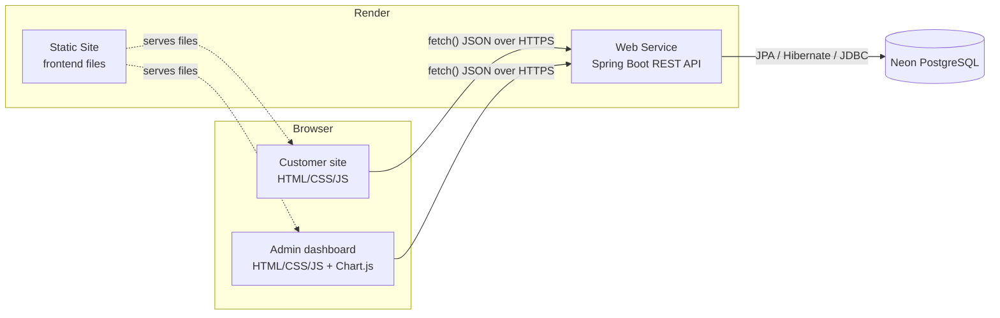
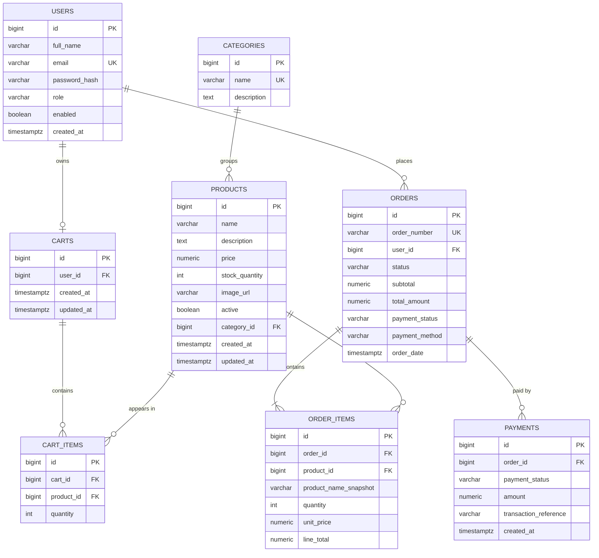

# Architecture — Shopping Cart & Order Management System

Java 21 · Spring Boot 3.x · PostgreSQL (Neon) · HTML/CSS/JS · Render

## 1. What the system does

Two web interfaces share one Java backend and one database.

- **Customer storefront:** browse and search products, manage a cart, check out (simulated payment), view own orders.
- **Admin dashboard:** manage products and stock, manage orders and their status, view revenue and low-stock reports.

## 2. Architecture



Backend layers:

```
Controller  ->  Service  ->  Repository  ->  Database
 (HTTP)        (rules,        (Spring Data     (PostgreSQL)
               transactions)   JPA)
```

## 3. Responsibilities

| Layer | Owns | Never does |
|---|---|---|
| Frontend | Rendering, user input, calling the API | Trust itself for security, stock or price checks |
| Backend | Authentication, authorization, validation, price and total calculation, stock checks, transactions, status rules | Render pages |
| Database | Permanent storage, constraints, relationships | Business decisions |

The browser never talks to the database. The backend holds the credentials and is the only gatekeeper.

## 4. ER diagram (proposed, to be refined in Phase 3)



Key design decisions:

- `NUMERIC(12,2)` for all money, never floating point.
- `order_items` stores a **snapshot** of name and price, so old orders stay correct after product edits.
- `CHECK (stock_quantity >= 0)`, `CHECK (quantity > 0)`, `UNIQUE (cart_id, product_id)`.
- Products are soft-deleted (`active = false`) once referenced by an order.

## 5. Checkout, the transactional heart

One `@Transactional` service method:

1. Load the authenticated user's cart items.
2. Lock each product row (`SELECT ... FOR UPDATE`, or an atomic `UPDATE ... WHERE stock_quantity >= ?`).
3. Verify stock and active flag; recompute prices from the database, ignoring client prices.
4. Insert the order, order items and simulated payment record.
5. Decrement stock and clear the cart.
6. Any failure rolls back everything, so there are no partial orders and no wrong stock.

## 6. Order lifecycle

`PENDING -> CONFIRMED -> PROCESSING -> SHIPPED -> DELIVERED`

`CANCELLED` is allowed only from `PENDING`, `CONFIRMED` or `PROCESSING`. Cancelling restocks the items and sets `payment_status` to `REFUNDED` (simulated). Revenue counts only non-cancelled orders with `payment_status = PAID`.

## 7. Roadmap

| Phase | Goal | Status |
|---|---|---|
| 1 | Requirements, architecture, DB design, API contract | In progress |
| 2 | Environment, Spring Boot project, health endpoint | Pending |
| 3 | Neon database, Flyway migrations, seed data | Pending |
| 4 | Entities, repositories, DTOs, public product API | Pending |
| 5 | Auth (register/login), roles, secure first admin | Pending |
| 6 | Cart, checkout, orders, customer frontend | Pending |
| 7 | Admin CRUD, order status, reports, admin frontend | Pending |
| 8 | Testing (stock, concurrency, authorization, persistence) | Pending |
| 9 | Deployment on Render + Neon | Pending |
| 10 | Report, diagrams, README, viva Q&A | Pending |

Build order for risk control: products -> auth -> cart -> checkout -> admin orders -> analytics -> polish.

## 8. Windows prerequisites checklist

| Item | Status (checked 2026-10-22) |
|---|---|
| Windows 11 x64 | OK |
| JDK 21 (Temurin 21.0.10) | OK; `JAVA_HOME` is not set (to fix) |
| Maven | Not installed; use the Maven Wrapper (`mvnw.cmd`) |
| Git 2.55 | OK |
| VS Code 1.140 + `code` on PATH | OK |
| VS Code Java extensions | To install |
| winget | Available |
| GitHub account | To confirm |
| Neon account | To create |
| Render account | To create |
| Postman or Bruno | To install |

## 9. Free-tier caveats (verify before launch)

Render free web services sleep after a period of inactivity and take a while to wake on the next request. Neon free databases also auto-suspend when idle. Neither guarantees 24/7 uptime, so warm both up before a demo and always keep a local copy that works.
